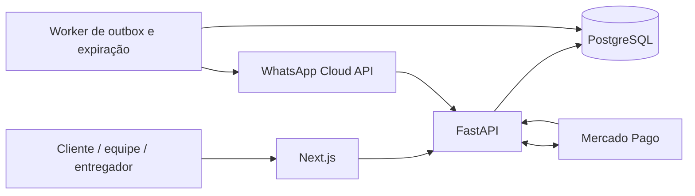

# Arquitetura

O Next.js apresenta a loja, a sacola, o checkout, o acompanhamento, o painel e a rota do entregador. Os endpoints `/api/v1/*` são encaminhados pelo próprio Next.js à API interna. Nenhum token dos provedores é enviado ao frontend. Imagens e fontes são servidas localmente.

O FastAPI autentica a equipe, valida horários no fuso de São Paulo, recalcula os preços e mantém as regras de estado. O PostgreSQL é obrigatório, inclusive nos testes: bloqueios de linha, atualizações condicionais e advisory locks são parte da consistência. O worker processa expiração e a outbox sem depender do navegador.

## Consistência

- O lote é único por sexta-feira e começa com 40 unidades. O comando condicional `available >= stock_units` garante que o estoque não fique negativo.
- Pedido, reserva, snapshot comercial e primeiro histórico são gravados na mesma transação. Hambúrgueres adicionais também consomem unidades.
- A chave de idempotência tem índice único e bloqueio transacional. Repetir um pedido com a mesma chave e conteúdo devolve o mesmo pedido e link; conteúdo diferente é rejeitado.
- Produtos e adicionais têm versões. Um carrinho com valores antigos recebe conflito, sem reserva ou cobrança.
- Bloqueios de catálogo são adquiridos em ordem estável. Expiração e cancelamento liberam estoque do lote original uma única vez.
- Itens são snapshots JSON imutáveis do ponto de vista comercial. O catálogo mantém ingredientes em JSON para facilitar a manutenção deste cardápio fixo de seis lanches. Novas entidades normalizadas podem ser acrescentadas sem alterar os snapshots.
- A reserva é representada pelo pedido associado ao lote, pelo total de unidades e por sua expiração; não há uma tabela redundante de reservas.

## Identidade e autorização

Senha administrativa com Argon2id e MFA TOTP obrigatório. A criação do administrador acontece por CLI e confirma o primeiro código antes de salvar a conta. Sessões duram oito horas, têm token aleatório armazenado como hash e cookie HttpOnly/SameSite Strict (Secure em produção). O backend verifica a sessão em cada ação administrativa, além de origem e cabeçalho CSRF nas mutações.

Links de acompanhamento usam HMAC-SHA256 com segredo de instalação e ficam armazenados como hash. O link expira sete dias depois da data de atendimento. Ele não revela o endereço completo de entrega nem o telefone. O endereço de retirada aparece somente após a confirmação. Links de rota são aleatórios, têm escopo para uma saída, expiram em quatro horas e podem ser revogados.

## Integrações e falhas

Pix é desativado até as credenciais estarem presentes e a demonstração desativada. O backend cria a cobrança com idempotência, valida a assinatura e a janela de tempo do webhook e consulta o pagamento no provedor. Referência, valor, moeda, método e identificador precisam conferir. Pagamentos tardios de pedidos cancelados/expirados entram em reembolso; eventos repetidos não duplicam a confirmação.

A outbox usa `FOR UPDATE SKIP LOCKED`, tentativas limitadas e backoff. Falha de WhatsApp não invalida pedido. Timeout ambíguo de envio de mensagem gera `uncertain` para conciliação, pois o provedor não oferece garantia de idempotência de envio. Não se promete entrega exatamente uma vez através de uma rede externa. Reembolsos usam chave de idempotência do provedor.

As credenciais externas e homologações não foram fornecidas: os contratos são testados com respostas simuladas; não representam aprovação do Mercado Pago ou da Meta.

## Modelo de dados

`products`, `add_ons`, `inventory_batches`, `orders`, `order_status_history`, `admins`, `admin_sessions`, `audit_logs`, `payment_events`, `outbox_events`, `delivery_runs` e `delivery_stops`. Endereço e personalizações pertencem ao snapshot protegido do pedido. A migração Alembic contém índices, chaves estrangeiras e constraints.

## Limites operacionais

O Compose usa uma instância de API. O rate limiting atual é por processo; antes de escalar para várias réplicas, adote uma política compartilhada no gateway ou Redis. O proxy deve restringir o acesso direto à API. A proteção de rede, TLS, backups gerenciados e criptografia em repouso devem ser configurados na hospedagem. Sem essas etapas e as homologações, esta entrega é para desenvolvimento e demonstração.
